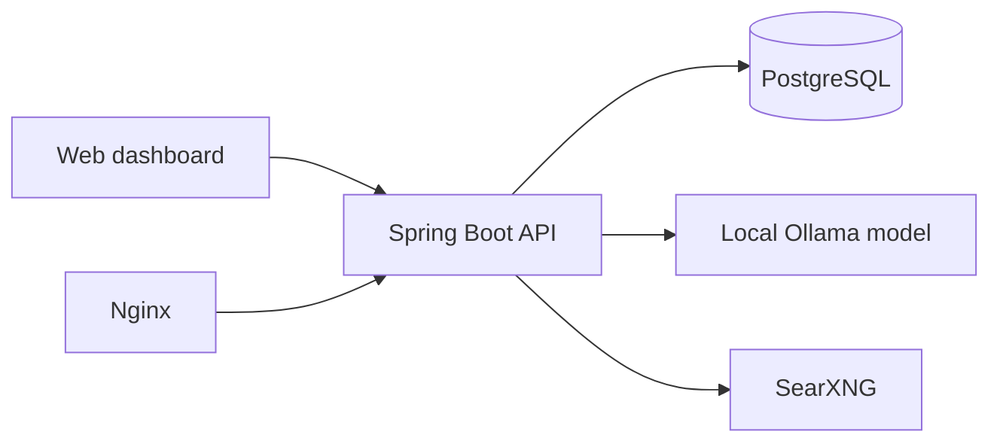

# HomeLab

**Self-hosted dashboard, backend services and local AI experimentation.**

A personal homelab project combining Spring Boot, PostgreSQL, Ollama, SearXNG and Docker on Linux. Built to explore backend development, API design, local AI and infrastructure automation.

## Features

- Task management with deadlines, priorities and completion state
- Local AI chat through Ollama with conversation history
- Long-term memory stored in PostgreSQL
- Search integration through a self-hosted SearXNG instance
- Web dashboard and system monitoring components
- Docker Compose, Nginx and automated PostgreSQL backup scripts

## Stack

| Area | Technologies |
| --- | --- |
| Backend | Java 21, Spring Boot 4, REST, Spring Data JPA |
| Storage | PostgreSQL, H2 local profile |
| AI | Ollama |
| Web search | SearXNG |
| Infrastructure | Ubuntu Server, Docker, Docker Compose, Nginx, systemd |
| Frontend | HTML, CSS, JavaScript |

## Architecture



## Repository structure

```text
homelab-api/       Spring Boot backend and dashboard
compose/           Docker Compose service definitions
nginx/             Reverse proxy configuration
scripts/           Backup and inventory utilities
systemd/           Linux service and timer files
inventory/         Example environment inventory
web/               Static web files
```

## Local setup

**Requirements:** Docker + Compose, a Java 21 environment for local backend development, and an accessible Ollama instance for AI features.

1. Create `compose/postgres/.env` locally (never commit it):

   ```dotenv
   POSTGRES_PASSWORD=replace-with-your-own-strong-password
   ```

2. Start PostgreSQL:

   ```bash
   docker compose --env-file compose/postgres/.env -f compose/postgres/compose.yaml up -d
   ```

3. Build the backend image and launch its Compose service:

   ```bash
   docker build -t homelab-api:local ./homelab-api
   docker compose -f compose/api/compose.yaml up -d
   ```

4. For SearXNG, create `compose/searxng/.env` with your own `SEARXNG_SECRET` and start:

   ```bash
   docker compose --env-file compose/searxng/.env -f compose/searxng/compose.yaml up -d
   ```

**Note:** This is an environment-specific homelab, not a plug-and-play production deployment. It expects the PostgreSQL schema to exist, uses a configured Docker network and contains local network addresses for services such as Ollama. Adjust these for your own environment.

## Selected API endpoints

| Endpoint | Function |
| --- | --- |
| `/api/tasks` | Create, read, update and delete tasks |
| `/api/ai/chat` | Chat with a local AI model |
| `/api/memory` | Store and retrieve memory |
| `/api/search?q=...` | Query the local search service |

## Security

Keep passwords, tokens and other credentials in local environment configuration and out of Git. Do not expose the dashboard or API to an untrusted network without appropriate authentication and hardening.

---

Built by [Marcin Kaczyński](https://github.com/kaczynskimarcin-spec).
